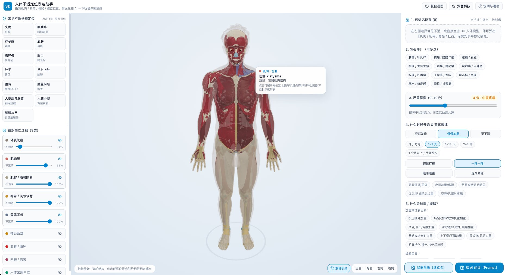

> 🌐 **中文版**: [README.md](./README.md)

# Body Pain Locator — 3D Interactive Anatomy & Symptom Articulation Tool

<p align="center">
  <a href="./LICENSE"></a>
  <a href="https://threejs.org/"></a>
  <a href="https://www.typescriptlang.org/"></a>
  <a href="https://github.com/huasanai/body-pain-locator/tags"></a>
</p>

<p align="center">
  
</p>

**Pinpoint exactly where it hurts in 3D — across muscles, tendons, ligaments, bones, nerves, organs, and acupoints — so doctors and AI immediately understand you.**

When preparing for a clinic visit or asking an AI assistant about health discomfort, the hardest part is describing *where* and *how deep* the pain actually is — superficial muscle tension, a tight hamstring tendon running down to the popliteal fossa, a sprained ligament, bone tenderness, radiating sciatic nerve tingling, or deep visceral discomfort. Body Pain Locator runs 100% locally in your browser to turn vague sensations into precise anatomical descriptions in three steps: **Locate → Describe → Export**.

https://github.com/user-attachments/assets/709fe3e1-3353-4f34-a970-65d26b7ecd9f

---

## Why I Built This

As we get older, my family, friends, and I run into random aches and pains more often. Before heading to the hospital, we usually want to ask an AI assistant first to get a clearer sense of what might be going on—only to realize how hard it is to put into words *where* it hurts and *what* it feels like. I built this interactive 3D human model so anyone can pinpoint discomfort intuitively: it helps us understand our own bodies better, and lets both AI tools and doctors understand our symptoms accurately from the start.

---

## Core Capabilities

<p align="center">
  
</p>

### 1. Granular 9-Layer Anatomical Transparency
Toggle visibility and adjust opacity independently across **Body Surface** (fully solid at 100%, translucent X-ray below), **Muscles**, **Tendons & Insertions**, **Ligaments & Joints**, **Skeleton**, **Nervous System**, **Cardiovascular**, **Visceral Organs & Sense Organs**, plus **WHO Standard Acupoints**.

### 2. X-Ray Depth Picking — No Manual Peeling Required
Click any spot on the 3D human model to cast a penetrating ray across all anatomical layers. A shallow-to-deep popover lists matching muscles, tendons, ligaments, bones, nerves, organs, and acupoints with **clinical terms, plain-language descriptions, English anatomical names, and typical pain cues** — plus one-click peeling for obstructing superficial muscles.

### 3. Medical Atlas Callout Leader Lines
Instead of cluttered giant spheres, Body Pain Locator renders crisp micro-pins connected via 45° elbow leader lines to collision-free side labels, with back-facing anchors automatically dimmed. Includes 13 one-click region presets (head, eye, neck, shoulder, scapula, chest, abdomen, upper limb & hand, lower back, anterior/posterior knee, posterior thigh & popliteal fossa, thigh & calf, ankle & foot) that fly the camera right to the optimal view and let you click callout labels directly to mark pain.

### 4. Structured Pain Questionnaire (OPQRST) & Local Red-Flag Alerts
Mark both primary pain points and radiating paths (visualized as 3D arcs), then record pain qualities, 0–10 NRS severity, onset/duration, triggers, relievers, and associated symptoms. Built-in deterministic red-flag rules immediately warn users to seek emergency care for high-risk patterns (e.g., crushing chest pain with cold sweats, thunderclap headache, cauda equina warning signs) alongside local department suggestions.

### 5. Dual Export — Ready for Doctors & AI
- **For Doctors (Visit Summary Card)**: Captures a crisp 3D snapshot of your marked viewpoint alongside anatomical terms, OPQRST details, and department hints — downloadable as a high-res PNG or printable on A4.
- **For AI Consultation (Structured Prompt)**: Compiles bilingual clinical terms, tissue depth, and complete OPQRST context into a high-signal Markdown prompt ready to paste into any LLM.

### 6. Dual Themes & Local-First Privacy
Switch effortlessly between **Clinical Light** and high-contrast **Tech Dark** modes with synchronized 3D studio lighting. Runs 100% client-side with zero backend and zero API keys; all session data stays in browser `localStorage` and can be wiped with one click.

---

## Quick Start

Requires [Node.js](https://nodejs.org/) (v20+ recommended).

```bash
# 1. Clone the repository
git clone https://github.com/huasanai/body-pain-locator.git
cd body-pain-locator

# 2. Install dependencies (postinstall automatically syncs local 3D anatomy GLB assets to public/)
npm install

# 3. Start the local dev server
npm run dev
```

Open `http://127.0.0.1:5173` in your browser.

### Useful Scripts

```bash
npm run dev             # Start local Vite dev server
npm run build           # Type-check and build static bundle into dist/
npm run preview         # Preview production build
npm test                # Run red-flag and department rule unit tests
npm run sync-assets     # Re-sync local 3D anatomy assets & attribution files
npm run verify-mapping  # Verify local GLB files, dictionary & acupoint mappings
```

---

## Design Principles

- **Articulation, not diagnosis**: Built strictly to help laypeople describe discomfort accurately. Emergency warning signs always rely on deterministic local rules.
- **Plain language meets clinical accuracy**: Every landmark pairs everyday phrasing with standard anatomical nomenclature so patients and clinicians speak the same language.
- **Built to evolve without rewrites**: The Three.js engine communicates with the UI strictly through a bidirectional `AnatomyBridge`, and all workflows read/write a versioned `SymptomSession v1` contract — ready for future live AI co-positioning or care navigation adapters without rewriting the core.

`v0.1.0` is the first public release. Track [Releases](https://github.com/huasanai/body-pain-locator/releases) for updates.

> **Medical Disclaimer**: This tool is intended solely to help organize and communicate physical discomfort. It does **not** provide medical diagnosis, treatment advice, or prescriptions. If you experience severe or emergency symptoms (such as crushing chest pain, shortness of breath, sudden severe headache, or sudden neurological deficits), seek immediate emergency medical care.

---

## Feedback & Contributions

Spotted an anatomical naming tweak, camera angle improvement, or want to contribute additional clinical regions/acupoints? Feel free to open an [Issue](https://github.com/huasanai/body-pain-locator/issues) or submit a Pull Request.

---

## Support & Connect

### Reach me

| Platform | Handle |
|---|---|
| 💬 WeChat | `huasanai` |
| 🐦 X | [@yfusionai](https://x.com/yfusionai) |
| 🎬 Douyin | [@画伞](https://v.douyin.com/zHu4VUhztes/) |

---

## License & Attribution

- Application source code is released under the [MIT License](./LICENSE).
- 3D human anatomy geometry is sourced from the open-access package `@authorod/svitylo-3d-anatomy-data` (integrating **Z-Anatomy** [CC BY-SA 4.0], **BodyParts3D** [© DBCLS, CC BY 4.0], **Human Reference Atlas** [CC BY 4.0], and **Brain for Blender** [CC BY-SA 3.0/4.0]). Full attribution and license notices are included in [ATTRIBUTION.md](./ATTRIBUTION.md).
