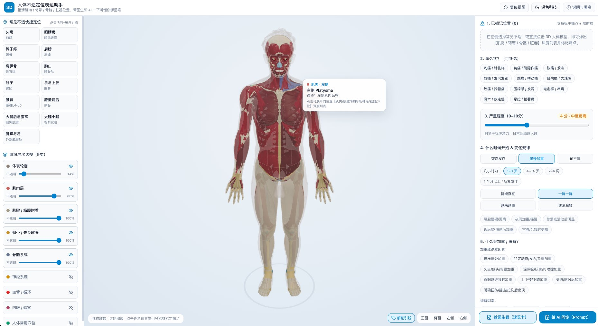

> 🌐 **English version**: [README.en.md](./README.en.md)

# Body Pain Locator — 3D 人体不适定位表达助手

<p align="center">
  <a href="./LICENSE"></a>
  <a href="https://threejs.org/"></a>
  <a href="https://www.typescriptlang.org/"></a>
  <a href="https://github.com/huasanai/body-pain-locator/tags"></a>
</p>

<p align="center">
  
</p>

**让普通人不用背医学名词，也能在 3D 人体模型上把「具体哪里疼、处于哪一层、怎么疼」清晰讲给医生和 AI 听。**

看病或向 AI 咨询健康问题时，最难说清的往往不是“疼不疼”，而是“到底哪儿疼”——是表层肌肉酸紧、大腿后面到腘窝那条硬筋拉扯、韧带扭伤、骨骼压痛、坐骨神经串麻，还是胸腹深处脏器闷痛？Body Pain Locator 把真实 3D 人体解剖、分层透视、标准穴位与临床疼痛表达框架装进一个纯本地运行的网页，帮你三步完成「精准定位 → 描述感受 → 一键导出」。

https://github.com/user-attachments/assets/709fe3e1-3353-4f34-a970-65d26b7ecd9f

---

## 我为什么做这个项目

随着年龄慢慢增长，自己和身边的亲戚朋友越来越常遇到“这儿疼、那儿不舒服”的情况。每次去医院前，大家常想先问问 AI 心里有个底，可真要打字形容时才发现——光靠嘴根本说不清到底是哪一块、有多深、是怎么个疼法。于是就想做一个能旋转、能分层透视的 3D 立体人体模型：一方面帮自己和家人更直观地认识身体，另一方面把痛点和感受整理得清清楚楚，不管是问 AI 还是当面和医生沟通，都能少走弯路、一次讲明白。

---

## 核心特性

<p align="center">
  
</p>

### 1. 精细组织层次透视，深浅一目了然
把人体拆分为 9 类可独立开关、调节不透明度的层次：**体表轮廓**（100% 呈完整实心外观，调低即半透明透视）、**肌肉层**、**肌腱与筋膜附着**、**韧带与关节软骨**、**骨骼系统**、**神经系统**、**血管循环**、**内脏与感官**，以及 **WHO 标准经络穴位**。

### 2. 射线穿透深度选择，不用手动一层层剥离
点击 3D 人体任意位置，系统通过全穿透射线拾取，自动由浅入深列出该点位下的肌肉、肌腱、韧带、骨骼、神经、脏器与穴位候选，附带**标准医学中文名 + 大白话通俗位置 + 英文解剖名 + 典型痛感提示**，还能临时剥离挡住视线的表层肌肉。

### 3. 专业医学图谱式「点 + 折线引导线」标注
放弃遮挡画面的大圆球，采用专业解剖图谱风格的精细针点与 45° 折线引导线，左右防重叠整齐停靠，背面锚点自动虚线淡化。内置 13 类高频不适快捷定位（头疼、眼睛疼、脖子疼、肩膀、肩胛骨、胸口、肚子、手与上肢、腰背、膝盖前后、大腿后与腘窝、大腿小腿、脚踝与足），一键飞镜直达并展开引导标签，点文字即可直接标痛点。

### 4. 结构化疼痛表达（OPQRST）+ 高危急症红旗提醒
支持主痛点与放射/牵涉痛路径标记，引导勾选 11 种大白话疼痛性质、0–10 疼痛评分、起病与演变规律、诱发/缓解因素及伴随症状。内置本地高危红旗规则与常见挂号科室参考——遇到胸痛压榨伴冷汗、突发剧烈头痛、马尾神经警示等危险组合时立即强提示优先急诊。

### 5. 双模式一键导出，同时适配医生与 AI
- **给医生看（就诊速览卡）**：自动同步截取当前 3D 标记画面，排版出清晰的一页式速览卡，支持下载高清 PNG 长图存手机或打印 A4 就诊单。
- **给 AI 问诊（结构化 Prompt）**：将精准中英文解剖名词、组织层级与完整疼痛特征组装为高信噪比提示词，一键复制粘贴给任意 AI 即可获得更有针对性的科普与挂号参考。

### 6. 双主题切换与本地离线隐私保护
内置**医疗清爽浅色**与**高对比深色科技**双主题，界面与 3D 影棚灯光实时联动。当前版本 100% 纯前端运行，无后端、无需 API Key，所有症状记录仅存本机浏览器 `localStorage`，随时一键清空。

---

## 快速开始

需要本地已安装 [Node.js](https://nodejs.org/)（建议 v20+）。

```bash
# 1. 克隆仓库
git clone https://github.com/huasanai/body-pain-locator.git
cd body-pain-locator

# 2. 安装依赖（postinstall 会自动将本地轻量化 3D 解剖模型同步到 public/）
npm install

# 3. 启动本地网页
npm run dev
```

启动后在浏览器访问 `http://127.0.0.1:5173` 即可使用。

### 常用命令

```bash
npm run dev             # 启动本地开发服务
npm run build           # 类型检查并构建生产静态包（输出至 dist/）
npm run preview         # 预览生产构建产物
npm test                # 运行临床红旗与科室规则单元测试
npm run sync-assets     # 手动重新同步本地 3D 解剖资产与署名文件
npm run verify-mapping  # 校验本地 GLB 资产、双语词典与穴位映射完整性
```

---

## 设计原则

- **表达助手，而非医生**：只帮助普通人把症状讲准、讲全，不做确诊和开药；高危急症永远通过本地确定性规则优先提醒线下就医。
- **普通人直觉优先**：每一处结构都同时提供大白话位置（如“大腿后外侧到膝盖后外侧那条硬筋”“膏肓区”）与标准医学名词，消除沟通鸿沟。
- **面向演进解耦**：3D 引擎通过双向控制总线 `AnatomyBridge` 与界面解耦，所有状态与导出统一读写强类型 `SymptomSession v1` 契约，方便后续无缝扩展实时 AI 协同定位或就近医院检索，而无需推翻现有架构。

`v0.1.0` 为首个公开版本，后续更新请留意 [Releases](https://github.com/huasanai/body-pain-locator/releases)。

> **医疗免责声明**：本工具仅用于辅助整理和表达身体不适位置与感受，**不构成任何医疗诊断、治疗建议或处方**。如出现胸痛发闷、呼吸困难、突发剧烈头痛、肢体无力或严重外伤等紧急情况，请立即前往医院急诊或拨打当地急救电话。

---

## 反馈与贡献

如果你发现某个部位名词不准确、视角不够顺手，或者想补充更多常见痛点与标准穴位，欢迎提交 [Issue](https://github.com/huasanai/body-pain-locator/issues) 或 Pull Request。

---

## 支持与交流

### 联系画伞

| 平台 | 账号 |
|---|---|
| 💬 微信 | `huasanai` |
| 🐦 X | [@yfusionai](https://x.com/yfusionai) |
| 🎬 抖音 | [@画伞](https://v.douyin.com/zHu4VUhztes/) |

---

## 许可与开源署名

- 本项目前端源代码采用 [MIT License](./LICENSE) 开源。
- 3D 人体解剖模型数据来源于开源医学解剖数据包 `@authorod/svitylo-3d-anatomy-data`（整合自 **Z-Anatomy** [CC BY-SA 4.0]、**BodyParts3D** [© DBCLS, CC BY 4.0]、**Human Reference Atlas** [CC BY 4.0] 与 **Brain for Blender** [CC BY-SA 3.0/4.0]），完整署名与许可证详情见 [ATTRIBUTION.md](./ATTRIBUTION.md)。
